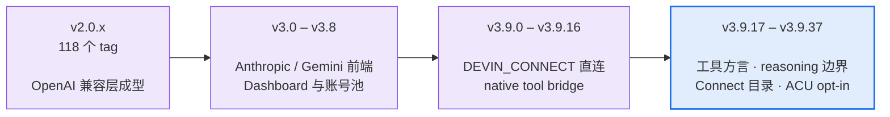

# Changelog

  <a href="#最近的版本">最近的版本</a> ·
  <a href="docs/releases/">全部 217 份发布说明</a> ·
  <a href="README.md">← 主 README</a>

> **这份文件是索引,不是权威。** 每个版本的完整说明在
> [`docs/releases/`](docs/releases/) 下,一版一份 —— 那里才写清了影响面、门禁数字和
> 判据。下面是版本提要,**只够你判断"这版要不要看"**；发布状态以固定 tag 与实际发行物为准。
>
> 版本号遵循 [语义化版本](https://semver.org/lang/zh-CN/)。本项目的实践是:
> **协议兼容性破坏才升 minor**,新增默认关的开关、修缺陷、补测试都是 patch ——
> 所以 patch 号跳得很快,而且 patch 里可能有很重的内容(例如 v3.9.21 是 50 个文件、
> 11 条客户端可见缺陷)。

## 版本节奏

| | |
|---|---|
| 发布说明 | **217** 份,v2.0.6 → v3.141.592657 |
| git tag | 227 个（2026-10-26 实测；以 `git tag \| wc -l` 为准） |
| 当前 | **v3.141.592657**(2026-10-26) |
| 运行时依赖 | **0** —— 从第一个版本保持到现在 |

## 最近的版本

下面是 3.9.x 全系。更早的版本请直接翻 [`docs/releases/`](docs/releases/)。

### [v3.141.592657](docs/releases/RELEASE_NOTES_3.141.592657.md) · 2026-10-26

D9 供应链控制落地:banner 生成器改为 commit + 逐文件 sha256 锁定、45 个 `uses:` 钉 SHA;Docker 镜像按 digest 用 cosign keyless 签名并发布 `image-digest.txt` + bundle,dashboard Docker OTA 解析 tag→digest、要求相等、按 digest pull 并校验 `RepoDigests`,deployer 镜像 digest 固定、所有 compose `up` 加 `--no-build`;源码 OTA 在改 Git 前校验签名的 `release-attestation.json`(默认 `warn`、`required` 可强开,`WINDSURFAPI_ATTESTATION_DIR` 支持预置)。同时修复 F3 截止边界最后一毫秒的 phase timeout 误分类(5 ms 容差,504 deadline 而非传输错误)。wire 对 v3.141.592656 **270/270 逐字节一致、0 差异**;mutation 语料 **97 份 spec / 863 条突变**（B03 按 Owner 指示走缩减路径：`spec-baseline-check --all` 97 specs / 0 drift；全量 sweep 发布后补跑），逐项计数见发布附录。D9 的 Owner 信任边界、真实 Docker/部署与 live 矩阵仍 `[UNVERIFIED]`。

### [v3.141.592656](docs/releases/RELEASE_NOTES_3.141.592656.md) · 2026-10-26

审计收口版:27 行 V 台账全部关闭(**4 P0 + 18 P1 + 5 P2**,修正旧版的 19-P1 算术;V-27 由 D4 关闭)、D 波 D1–D8/D10 落地(D9 仅设计)、F2 final-sweep 文本不再被误判为空轮、F3 路由预算从 producer 入口起算。wire 对 v3.141.592655 **270/270 逐字节一致、0 差异**;全量 mutation 覆盖 **97 份 spec / 862 条突变**(17 条声明 survivor),逐项计数见发布附录。真实上游/Docker/部署与 D9 仍 `[UNVERIFIED]`。

### [v3.141.592655](docs/releases/RELEASE_NOTES_3.141.592655.md) · 2026-10-25

wave-4–7 七条修复与三份基础设施:`supports_images` 从广告变成门(显式 false 才剥离并计数,按服务账号取能力位,终端空图片轮 400)、#273 乱序 `tool_result` 移到调用之后(本版唯一有意 wire 变化,270 个比较中 12 个,允许列表逐条声明)、#159 `success` 作为可用信号并按 GetUserStatus 新鲜度设界、失败尝试历史与 billed 窗口保护、上游显式 4xx 校验拒绝从 503 改为 400 `REQUEST_REJECTED`、support bundle 解析并脱敏请求凭据/省略不可证明的二进制 leg、未验证登记册与 §0 src-lag 守卫。wire 对 v3.141.592654 **258 相同 + 12 声明 = 270/270**;全量 mutation **96/96 spec / 855 条**（841 捕获 + 14 条声明,0 drift）。

### [v3.141.592654](docs/releases/RELEASE_NOTES_3.141.592654.md) · 2026-10-25

wave-3 七条修复:Cascade 重放历史图片不再静默丢弃、Codex `parallel_tool_calls:false` 从 400 改为服务并计数、chat 面对 server-executed 工具类型显式 400、Claude Code 2.1.306 的 `context_management`/`defer_loading`、usage 把 cache-write 计入输入、别名与方言整类修复、Responses/Gemini 参数保真与 `metadata` 回声。mutation 基线门默认改为按变更域测量。wire 对 v3.10.1 **270/270**、全量 mutation **92/92 spec**(822 条 = 808 捕获 + 14 条声明,0 drift)。

### [v3.10.1](docs/releases/RELEASE_NOTES_3.10.1.md) · 2026-10-24

三个硬化修复:明文 `http:` 图片默认拒(`WINDSURFAPI_ALLOW_HTTP_IMAGES=1` 逃生)、`/v1/responses` 对 8 种 server-executed 工具类型显式 400(不再静默丢弃)、`glm-5-1` 破折号拼写的路由与工具方言(此前静默降级免费档 + 错方言卡死)。wire 270/270 vs v3.10.0。

### [v3.10.0](docs/releases/RELEASE_NOTES_3.10.0.md) · 2026-10-23

大版本：detached cache P1（默认关）+ 四个 P2 修复、账号页 P2（调色板/尺度/排序/改名）、
SEC 四项（空白密码、runtime-config/proxy ACL、nginx Referer、cosign keyless 发布签名）、#245 `teams_tier` 行、
smoke 137 flows / 24 families、真实 Docker one-click E2E 4/4。
### [v3.9.60](docs/releases/RELEASE_NOTES_3.9.60.md) · 2026-10-23（已发布）

detached cache P1（惰性恢复，默认关）：快照 v2 四字段、可声明 registry、请求级租约、两个计费陷阱；
#245 `teams_tier` 日志行（raw + mapped）。新增 48 条测试，flag-off 与既有 cascade 套件 150/150 一致。
### [v3.9.59](docs/releases/RELEASE_NOTES_3.9.59.md) · 2026-10-23（已发布）

发布工作流 Test job 超时 10 → 20 分钟：506 文件 / ~6,250 测试在托管 runner 上已超过 10 分钟，
v3.9.58 的 Release 因此被取消。产品代码零改动。
### [v3.9.58](docs/releases/RELEASE_NOTES_3.9.58.md) · 2026-10-23（已发布）

修复重试预算竞态：`budgetedSleep` 不再“睡剩余时间后报告成功”，两条重试循环在退避后重新检查预算；
四个确定性测试（无墙钟）在修复前全红。这是 v3.9.57 CI 唯一的失败点。
### [v3.9.57](docs/releases/RELEASE_NOTES_3.9.57.md) · 2026-10-23（已发布）

修复发布门：GitHub Actions 的 `actions/checkout` 把 `refs/tags/vX` 强制指向提交，守卫却要求它是
annotated 对象，导致 v3.9.54/55/56 的 Release 全部在 Test 失败。现在两种 ref 形态都能通过，本地
annotated 检查不放宽；非祖先/伪造 SHA 仍红。
### [v3.9.56](docs/releases/RELEASE_NOTES_3.9.56.md) · 2026-10-23（已发布）

ACU 按量余额改为有符号美元（负数 = 已透支，不 clamp，亚分显示 6 位）；`?key=` 弃用与发布签名文档；
**修复 SHA256SUMS 平铺名**（3.9.53 清单用 `dist-windows/…`，3/4 资产 `sha256sum -c` 失败）。
### [v3.9.55](docs/releases/RELEASE_NOTES_3.9.55.md) · 2026-10-23（已发布）

账号页 P0-4/P1：动词与落点一致（添加→登录/导入/粘贴凭证）、状态筛选 4 组（原始 10 态折叠）、
抽屉 4 主卡 + 6 技术卡折叠、行内上次检查 + 车队结果面板（含被排除账号）、用量页人话、登录分步。
### [v3.9.54](docs/releases/RELEASE_NOTES_3.9.54.md) · 2026-10-23（已发布）

账号页 P0（KPI 划分、共享余额去重、人话、可取消的车队任务 + 结果面板）；文档漂移守卫（版本/tag/
banner/notes 链接）；3.9.53 审查修正（#236 检测顺序、Docker exec 超时、notes 勘误）。

### [v3.9.53](docs/releases/RELEASE_NOTES_3.9.53.md) · 2026-10-23

CascadeTurn 生产者对象（`WINDSURFAPI_CASCADE_TURN`，默认关，快照缺逐 step 游标即拒绝）；Docker 一条命令
更新 `deploy/update.sh`（健康门 + 自动回滚）；五项安全修复（空白 dashboard proof 不再付 scrypt、nginx 不记
query、Windows ACL、SHA256SUMS、secret-scan 未加引号规则）；GitHub backlog #272/#258/#236；出站历史预算
（413 `history_budget_exceeded`）与 PR #274 孤儿守卫；smoke 矩阵扩到 124 条 / 20 族。

### [v3.9.52](docs/releases/RELEASE_NOTES_3.9.52.md) · 2026-10-22

账号 `reauth` 状态（选择器跳过、免费 GetUserStatus 探针门控、409 防误清、重登替换行、删除账号
同时删凭据）；Node 支持收紧到 `>=22.13.0`，Node 20 明确不支持，发布门仍是 24.x。

### [v3.9.51](docs/releases/RELEASE_NOTES_3.9.51.md) · 2026-10-22（已发布）

登录 wave 3：双 host 探测、无密码账号/未知探测分类、Auth1 先于 Firebase、无状态 token 导入、
验证码 UI 与倒计时、CDP token 捕获脚本；ACU/用量面板（按 org 去重、每日/产品、空/错误态）。

### [v3.9.50](docs/releases/RELEASE_NOTES_3.9.50.md) · 2026-10-22（已发布）

重试所有权收敛（适配器管传输、handler 管账号 failover，5xx 恰好 2 次；re-login signal 可达；
进程级突发窗口；ACP 一次有界重试）；账号页 v3（登录/导入/添加合并、请求历史、骨架/错误/空态、
焦点陷阱）；108 条 smoke 矩阵 + 14/14 负向突变。

### [v3.9.49](docs/releases/RELEASE_NOTES_3.9.49.md) · 2026-10-22（已发布）

协议按描述符修正（StopReason 映射、int64 字符串余额、tool_choice oneof）；LS 安装器改为清单 +
固定哈希，默认 3.10.67、可回滚 3.5.17、失败即停；账务 UI 未知显示 `—`，不再编造 0/日期。

### [v3.9.48](docs/releases/RELEASE_NOTES_3.9.48.md) · 2026-10-22（已发布）

登录/账号页/模型/可靠性四条线：不存在的邮箱不再误判、验证码可重试且只发一封；批量删除不再
误删隐藏行、封禁账号可见、探测 skipped 不再算成功；免费/付费由 costTier 驱动、配额消息归
`insufficient_quota`；预内容失败保留 429/503 + Retry-After，新增单请求预算（600s/300s，轮次上限 6）。

### [v3.9.47](docs/releases/RELEASE_NOTES_3.9.47.md) · 2026-10-22（已发布）

Devin 能力卡：ACU 账本（只展示可观测字段，`no_billing_tag` 显式）、模型四态、Key 轮换
（masked，过期不可观测时显式 unknown）、容量预检（失败显示未知而非 unlimited）。60 条新测试，
194 条相关批次，截图 25/25。

### [v3.9.46](docs/releases/RELEASE_NOTES_3.9.46.md) · 2026-10-22（已发布）

账务显示修复：`GetUserStatus` 的 uint64 余额 `-1` 哨兵不再被当成 `$18,446,744,073,709.43`
计入账号池；解码层只接受 0..$1,000,000，刷新层清除旧值，聚合层忽略哨兵/超界值。

### [v3.9.45](docs/releases/RELEASE_NOTES_3.9.45.md) · 2026-10-22（已发布）

账号管理重做：登录/导入/维护合并为一页，KPI 条 + 服务端筛选 + 9 列表格 + 抽屉 + 吸底批量操作，
Key 只显示 masked，8 态徽章与 AA 对比，`/accounts/ids` 与 `/accounts/batch` 新 API，组合筛选
`total` 修复。新增 `npm run smoke:dashboard` 17 条真实 HTTP 流程并接入 CI。无协议破坏。

### [v3.9.44](docs/releases/RELEASE_NOTES_3.9.44.md) · 2026-10-22（已发布）

登录修复：OAuth-only 账号不再被误判成密码错误（`has_password` 才是密码信号），并补上邮箱验证码
登录（probe / email/start / email/complete，服务端 flowId，10 分钟 TTL/一次性/5 次尝试/30 秒冷却）；
Devin host 可回退。DEVIN_CONNECT 帧队列加上限（4096 帧 / 8 MiB，背压暂停/恢复）与 relogin 等待
超时/中止。无协议破坏，无默认开启的新开关。

### [v3.9.43](docs/releases/RELEASE_NOTES_3.9.43.md) · 2026-10-22（已发布）

v3.9.42 之后的两条补丁：ACP 的 `tool_call`/`tool_call_update` 不再被丢弃，工具类 `stopReason`
投影成 `tool_calls` + `finish_reason:"tool_calls"`，无法映射时返回 502 而不是静默 `stop`；
Dashboard `.main{min-width:0}`，账号页/概览页在 1440/390 下不再横向溢出，表格只在自身容器内滚动。
无协议破坏、无新路由、无默认开关变化。

### [v3.9.42](docs/releases/RELEASE_NOTES_3.9.42.md) · 2026-10-22（已发布）

v3.9.41 之后的加固补丁（8 条分支）：客户端断开后不再缓存/计费/复用半截答案（流式跳过完成尾，
非流式返回 499）；Cascade SSE 增加写端背压门与 `WINDSURFAPI_MAX_DRAIN_MS` 上限，慢读客户端不再
买到无限上游工作；Messages 在工具块打开时持有交错文本（参数不再被截成 `{"path"`）并把
`tool_result.is_error` 传播到所有工具；Responses 修掉空尾 `message` 与分片 `function.name` 冻结；
重复的上游 call id 在 Messages/Responses/Gemini 三个出口唯一化；SSE 修前导 BOM、提交后失败帧
扫描与 typed ping 提交门；Node 20/22 的 Connect 绝对 deadline 不再被 unref；补 4 条流式两轮工具
循环测试。无协议破坏、无新路由、默认 wire 由门禁对 `v3.9.41` 基线比较。

### [v3.9.41](docs/releases/RELEASE_NOTES_3.9.41.md) · 2026-10-19（已发布）

v3.9.40 之后的一次大补丁（90+ 个提交，57 feat/fix）：工具名/ID/历史跨三方言收敛，Messages 的 split
tool name 不再以首片开块；SSE 提交门在写 200 前裁决预内容错误，混合帧/CRLF/超长帧有共用 framer；
Dashboard 补账号用量、池冷却、请求环、目录差异和计费 burn-down，密钥前缀不再渲染；Connect 刷新
live 目录/模型并修传输与限流重试；账号过滤、日志保留/轮转、ACP 原生配置均为默认关的可选项。
发布审计后补：`WINDSURFAPI_TOOL_HYGIENE=0` 完整回滚、重复 tool ID/FIFO 配对、孤儿结果不拆 tool 对、Anthropic 错误状态补齐、Gemini split 名与 Dashboard token fallback。默认 wire 不变（270/270），本地/HMC 全量绿；昂贵模型 5 selector × 4 协议 20/20 200。无协议兼容性
破坏；实际计费 debit、其余模型图片和 Any2API live 集成仍未验证。

**2026-10-21 维护增量（代码候选 `f2b938d`，旧数字为 2026-10-19 快照）**：畸形/超长 tool id 保留
FIFO 队列；预内容 Cascade 失败不再追加成功 `[DONE]`；SSE framer 与网络分片无关，支持 LF/CRLF/CR、
空字段和注释开头内容，分隔符扫描改为单游标。本机 Node 24 固定批次观测 160k 帧约 28 ms（修复前约
3.6 s），不作为通用延迟保证。Windows `npm run gate`（含 `test:release`）**5,415 pass / 0 fail /
82 skip**，Linux release **5,497 pass / 0 fail / 0 skip**，wire **270/270**；受影响 mutation 共
**11** 个预期（10 caught + 1 declared survivor）。Linux 首次聚合 gate **exit 2** 是 detached clone
缺 `origin/master`，补跑缺失层为 **85 specs / 0 drift / 0 untrustworthy**。Any2API 候选 `a4b3406`
是独立项目：LF 集成树 `go test ./...` 为 **18 ok + 1 no-test / 0 fail**，二进制已构建并固定哈希；
其 live 结果不在本版范围，不作为本版证据。

**2026-10-22 发布集成（`release/3.9.41`，六条分支合入）**：分片工具参数在 chat/Messages/Responses/
Gemini 四出口按 1/128/4096 字节逐字节重组（补覆盖，8 条突变全捕获）；Messages 并行工具调用参数交错
不再丢片；终态后错误不再被吞；SSE 多行 `data` 固定；Gemini `oneOf`/属性级 `allOf`/数字 `enum` 保真度
characterization；Cascade 历史改按 UTF-8 计数、步骤读取改为有界重叠（工具活跃停顿上限保留）；
“Panel state lost” 终态不再按传输错误轮换账号；流式失败类写入请求环；Windows LS 放行 `APPDATA`。
Live：付费 devin-team 账号 3 个 selector 可达；#272 assistant 轮图片被上游忽略；#236 GLM-5.2 工具调用
正常；#239 付费回合 wire 无计费标签；#250 3 回合未复现、维持 inconclusive；workspace trust #4 验证。
Windows release **5,507 pass / 0 fail / 82 skip（452 文件）**、gate **PASS**；Linux release **5,588 pass /
0 fail / 1 skip（452 文件）**；wire **270/270**；mutation **170 条：167 caught + 3 declared survivor**。未打 tag、未 push。

### [v3.9.40](docs/releases/RELEASE_NOTES_3.9.40.md) · 2026-10-07

畸形输入不再打成 500 或变成上游文本:带 per-user scope 的 `content:[null]`、`system:[null]` 和
`/v1/responses` 的空 `content: []` 现在都按既有规则在本地裁决(共用 400 / 转换器放行)。仪表盘显示
解码后的 ACU 成本(仅有值时、绝不显示假 0,子分位不压平);校准器不再把费用坐标 `#22` 当模型名;
thinking 块始终携带 `signature`(PR #278)。工程侧:请求尾契约成文、CONTRIBUTING 补审查合并标准
(RC0–RC12)、s2-b 突变规格收窄后可评分、八处烂数字改指来源。无新路由、无新增字段(`signature`
为既有字段、现始终存在)、无默认开关变化;无 live-account 验收。

### [v3.9.39](docs/releases/RELEASE_NOTES_3.9.39.md) · 2026-10-05

上游错误响应体在**流式与 unary 两条读取路径**上都没有上限:一个坏上游的 600 MiB 5xx 就能
`ERR_STRING_TOO_LONG` 退掉整个进程,所有租户断连。三处读取改用共用的带上限累加器(8 MiB,可 env
覆盖),截断保留真实前缀——修复后同样的 600 MiB 响应退出 0 + `UPSTREAM_ERROR` + 截断标记。
门禁新增**逐文件 inert 普查**:声明了测试却一条没执行的文件(含整段 `describe.skip`)判红并点名,
宿主需显式声明两条;`mutate-verify` 把被取消的 baseline 报成"截断"而非失败套件。突变全量扫描
2026-10-05 首次在 HMC bench 原生跑完(84 份规格 / 759 条突变)。无公开接口、路由、字段或默认
开关变化;无 live-account 验收。

### [v3.9.38](docs/releases/RELEASE_NOTES_3.9.38.md) · 2026-09-23

已发布，固定 tag 指向 `0b78217`：保全代理工作区、固定凭据 v1 标签长度、修正扫描完整性与
baseline 执行证据，并补真实路由和历史覆盖测试。旧模板不再自动重写是明确的升级取舍。
其后合入主线的强化 boot-smoke、scanner cwd 修正和 CI 接线不属于这个已发布 tag；
后续代码更新使用新版本，不重指 `v3.9.38`。完整范围、历史验收与未修项见对应发布说明。

### [v3.9.37](docs/releases/RELEASE_NOTES_3.9.37.md) · 2026-09-17

对 v3.9.36 的独立对抗审查(1 P1 + 4 P2,全部复现后修复)。**凭据库锁重写为实例身份**:并发写不再可能
丢记录(旧实现的两个回收者会互删新锁)、写者中途死亡不再需要人工解锁;固定路径改为永久哨兵文件,
新旧版本不会互相覆盖。CI 的 wire 门禁修掉"在已打 tag 的提交上与自身比较"的退化,改为选择严格祖先的
annotated release tag。`credentialStored` 只在实际落盘后为真;会话索引 resolve 路径不再泄漏归属。
运维注意:旧版崩溃留下的空 `.lock` 目录不会被自动接管,删掉即恢复(有意保守)。默认路径字节不变。

### [v3.9.36](docs/releases/RELEASE_NOTES_3.9.36.md) · 2026-09-17

PR #271(并行工具调用間的游离文本折叠,含丢图/空 ID/字段丢失三处评审修正)+ 六条独立审计线:请求路径白给 CPU(缓存键门控、单遍 prompt、正则提升、前缀表、图像 base64)、编码器与分帧器的复制放大、可靠性(索引淘汰、租户公平份额、额度刷新合并、响应存储边界、JWT 淘汰、流失败分层)、安全(凭据库写竞态与锁回收、可信客户端 IP、主机白名单、原型键、日志脱敏)。**默认路径字节不变现在是 CI 门禁**(270 帧对拍)。无 API 破坏。

### [v3.9.35](docs/releases/RELEASE_NOTES_3.9.35.md) · 2026-09-16

`DEVIN_CONNECT_REPLAY_REASONING` 开启时,只带 reasoning 的 assistant 回合不再被空回合过滤器吞掉;orphan 过滤器与 reasoning replay 的注释写准并加守卫(行为零变化,默认路径逐字节不变)。无 API 破坏,ACU `^22` 仍默认关。

### [v3.9.34](docs/releases/RELEASE_NOTES_3.9.34.md) · 2026-09-14

四条外部 PR：连续同 role 文本不再打成 run≥3；Responses 工具图进 `#10`；nginx 不再 1m 挡多模态；本机导入认 Devin 桌面目录。`swe-2` 进 Connect 目录。无 API 破坏，ACU `^22` 仍默认关。

### [v3.9.33](docs/releases/RELEASE_NOTES_3.9.33.md) · 2026-09-14

工具前言阶梯不再构造注定被丢弃的那一档：病态 `$ref` 钻石形请求 **−92%**，普通请求无可测变化。无 API 破坏，响应逐字节相同，ACU `^22` 仍默认关。

### [v3.9.32](docs/releases/RELEASE_NOTES_3.9.32.md) · 2026-09-13

面板读失败时不再清空上一次的数据；工具前言 `$ref` 钻石形 −61%（34 工具档 −24%）；CI 的绿终于等于"测试跑完了"。无 API 破坏，ACU `^22` 仍默认关。

### [v3.9.31](docs/releases/RELEASE_NOTES_3.9.31.md) · 2026-09-04

Connect 上 allowlist/blocklist 的 `glm-5.1` 与 `glm-5.2` 视为同一条。Cascade 仍分开。ACU `^22` 仍默认关。

### [v3.9.30](docs/releases/RELEASE_NOTES_3.9.30.md) · 2026-09-04

`/v1/models` 列出 glm-5.2 而不是被 glm-5.1 别名挡住。精确 overlay，不是按前缀排序。ACU `^22` 仍默认关。**升级：** 名单里仍写着 `glm-5.1` 的，自动发现客户端会请求 `glm-5.2`；门在 v3.9.31 修。

### [v3.9.29](docs/releases/RELEASE_NOTES_3.9.29.md) · 2026-08-28

Dashboard 401 不再刷空 stats 表；login/OTP 先脱敏再截断。OTA 才能吃到 `09bde39` 同类 401 空表。ACU `^22` 仍默认关。

### [v3.9.28](docs/releases/RELEASE_NOTES_3.9.28.md) · 2026-08-23

旱灾闸放行 Pro 上不吃周配额的 `swe-1-7` / `glm-5-2`（#258）。不扩免费账号 entitlement。ACU `^22` 仍默认关。

### [v3.9.27](docs/releases/RELEASE_NOTES_3.9.27.md) · 2026-08-22

API Key 框同样分类（#257）；401 不再刷空表；RegisterUser 先脱敏再截断。ACU `^22` 仍默认关。

### [v3.9.26](docs/releases/RELEASE_NOTES_3.9.26.md) · 2026-08-21

贴 auth-token「Add failed」、列表看起来空（#257）。session / show-auth-token URL 走对路；401 不再吞成 Add failed。ACU `^22` 仍默认关。

### [v3.9.25](docs/releases/RELEASE_NOTES_3.9.25.md) · 2026-08-21

非流式挂断拆上游（messages / Gemini / Responses）、新安装 `DEFAULT_MODEL=claude-sonnet-4.6`、fail-closed 文档对齐。ACU `^22` 仍默认关。

### [v3.9.24](docs/releases/RELEASE_NOTES_3.9.24.md) · 2026-08-20

Cascade 元数据门、Connect 目录按账号同步、OpenAI 兼容补全(logprobs 400 / completions / 稳定 created)、ACU 解码 opt-in(默认不开 `^22`)。

### [v3.9.23](docs/releases/RELEASE_NOTES_3.9.23.md) · 2026-08-17

SWE-1.7 原生视觉、按账号刷新的在线模型目录、Claude Code system 消息兼容，以及 OTA 更新目标修正。

### [v3.9.22](docs/releases/RELEASE_NOTES_v3.9.22.md) · 2026-08-16

OTA 自更新三件套（tag 门禁 + 失败回滚 + UI）+ 工具族三个已知缺陷。文件名带 `v` 前缀，是历史拼名，不是新版本。

### [v3.9.21](docs/releases/RELEASE_NOTES_3.9.21.md) · 2026-08-08

一份 16 条的外部审计清单,作者明确说明**自己没有验证过任何一条**。逐条裁定后: 11 条修掉,3 条判为"真实但不值得修"并写了理由,2 条本来就已覆盖。**其中 4 条报告把自己的成因说错了** —— 下面按修正后的成因描述。

### [v3.9.20](docs/releases/RELEASE_NOTES_3.9.20.md) · 2026-08-06

Gemini 客户端在上游返回**畸形工具参数**时,拿到的是一个参数全空的工具调用 —— 而日志里什么都没有。这一版修掉它。

### [v3.9.19](docs/releases/RELEASE_NOTES_3.9.19.md) · 2026-08-05

v3.9.18 给 reasoning digest 的上限加了一道钳,**而那道钳只堵了一半**。这一版堵另一半。

### [v3.9.18](docs/releases/RELEASE_NOTES_3.9.18.md) · 2026-08-05

上游有时把一整轮花在"想"上 —— reasoning 有内容、工具调用零个、`finish=stop`。对 agentic客户端来说这就是**光想不做**,自主循环停在那里等一个永远不来的工具调用。

### [v3.9.17](docs/releases/RELEASE_NOTES_3.9.17.md) · 2026-08-05

一个写法差异让 GLM-5.2 拿到了它会忽略的工具方言 —— 症状是工具调用永远不发出来，客户端一直等。

### [v3.9.16](docs/releases/RELEASE_NOTES_3.9.16.md) · 2026-08-05

面板现在告诉你每个模型吃不吃配额 —— 而在它不知道的时候，明说不知道。

### [v3.9.15](docs/releases/RELEASE_NOTES_3.9.15.md) · 2026-08-05

面板列的模型和实际能调的模型此前是两套；Cascade 流式的账没记；九个 CI action 升到 node24。

### [v3.9.14](docs/releases/RELEASE_NOTES_3.9.14.md) · 2026-08-04

一条外部报告的预算耦合，和一个把突变工具整个关掉、却伪装成"你的套件坏了"的环境变量。

### [v3.9.13](docs/releases/RELEASE_NOTES_3.9.13.md) · 2026-08-04

一个真实缺陷 + 一个默认关的开关 + 一轮把**自己这一轮的修复**也审了的对抗复核。

### [v3.9.12](docs/releases/RELEASE_NOTES_3.9.12.md) · 2026-08-04

清 `HANDOFF-2026-08-04.md` §4.1 剩下的三条 sticky/守卫积压。**三条里只有一条是"实现一个功能",另外两条的结论是"不该按它写的方式做"** —— 一条实测净负面已 revert,一条正确答案是不接线。

### [v3.9.11](docs/releases/RELEASE_NOTES_3.9.11.md) · 2026-08-04

清 `HANDOFF-2026-08-03.md` 剩下的守卫与 sticky 积压。**三项里只有两项是真缺陷** ——第三项是设计张力,记下来而不是改掉。

### [v3.9.10](docs/releases/RELEASE_NOTES_3.9.10.md) · 2026-08-04

两条用户可感知的修复,都是本轮用**真实账号**跑出来的。

### [v3.9.9](docs/releases/RELEASE_NOTES_3.9.9.md) · 2026-08-03

v3.9.8 发出去之后继续清 `HANDOFF-2026-08-03.md` 的积压。三条真实缺陷修复 + 两条守卫补缺 + 一条门禁偶发失败。

### [v3.9.8](docs/releases/RELEASE_NOTES_3.9.8.md) · 2026-08-03

**#234 / #235 / #239 的主体。** 一条外部报告(@andya1lan 的 backend 错配)往下挖出四层,其中两层是**只修一层就会制造事故**的关系。

### [v3.9.7](docs/releases/RELEASE_NOTES_3.9.7.md) · —

四个正在伤害生产的缺陷,加上一批"全绿套件掩盖不了的"测试与文档修正。

### [v3.9.6](docs/releases/RELEASE_NOTES_3.9.6.md) · 2026-07-31

一轮代码质量复核的产出。修掉三个仍在**误把健康账号打下线**的上游错误码,并修正五条自己写的假测试 —— 其中两条被证实完全测不到它们声称守护的东西。

### [v3.9.5](docs/releases/RELEASE_NOTES_3.9.5.md) · 2026-07-31

两个外部 PR 合并 + 检索端点的一批契约修复。另外修掉一个**我们自己漏了四个版本**的发布链缺口:`macOS x64` 二进制其实从 v3.9.1 起就没有产出过。

### [v3.9.4](docs/releases/RELEASE_NOTES_3.9.4.md) · 2026-07-29

`GET` / `DELETE /v1/responses/{id}` **自 v3.9.1 发布起对所有客户端都不可用** ——任何客户端形态都必然 404。用到这两个端点的部署需要升级;其余部分无变化。

### [v3.9.3](docs/releases/RELEASE_NOTES_3.9.3.md) · 2026-07-28

v3.9.2 的补丁版。它修的那条 blocker **只修了 3 条内部路由里的 1 条** —— `/v1/messages` 和 `/v1beta`(Gemini)上,中途断开的流照旧被报成正常完成。

### [v3.9.2](docs/releases/RELEASE_NOTES_3.9.2.md) · 2026-07-28

v3.9.1 的补丁版。发版后做了一轮对抗复核,查出 3 条缺陷 —— **全部是 v3.9.1 自己的修复引入的**,其中 1 条 blocker 让 v3.9.1 的主打修复在**默认后端**上完全失效。

### [v3.9.1](docs/releases/RELEASE_NOTES_3.9.1.md) · 2026-07-28

修 v3.9.0 的一批缺陷。**主线是一类反复出现的错误模式:把"不知道"当成"没事"** ——缺失的流终止帧当成正常结束、未校准的枚举值当成已知语义、缺失的 `finish_reason`当成良性完成。三处都在信息不足时选了乐观解释,代价都是把坏结果报成好结果。

### [v3.9.0](docs/releases/RELEASE_NOTES_3.9.0.md) · 2026-07-27

Responses API 拿到真正的服务端会话状态,账号池少了一条会误伤健康账号的路径,并首次用**付费账号**把挂了几个月的 wire 校准问题跑通。

## 更早的版本

v2.0.6 到 v3.8.x 共 150 份说明,都在 [`docs/releases/`](docs/releases/) 下。
文件名规则是 `RELEASE_NOTES_<版本号>.md`,所以想看某一版直接拼路径即可,
例如 [`docs/releases/RELEASE_NOTES_3.0.0.md`](docs/releases/RELEASE_NOTES_3.0.0.md)。

## 想知道某个改动为什么这么做

发布说明讲"改了什么",[`docs/AUDIT-LEDGER.md`](docs/AUDIT-LEDGER.md) 讲"怎么发现的、
判据是什么、哪些结论后来被推翻了"。十七轮追加,按时间排列 —— 它记录的方法论
比单条修复更有用。
